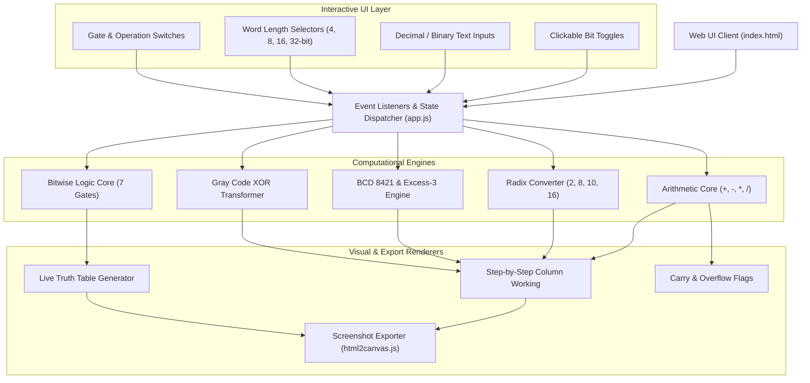
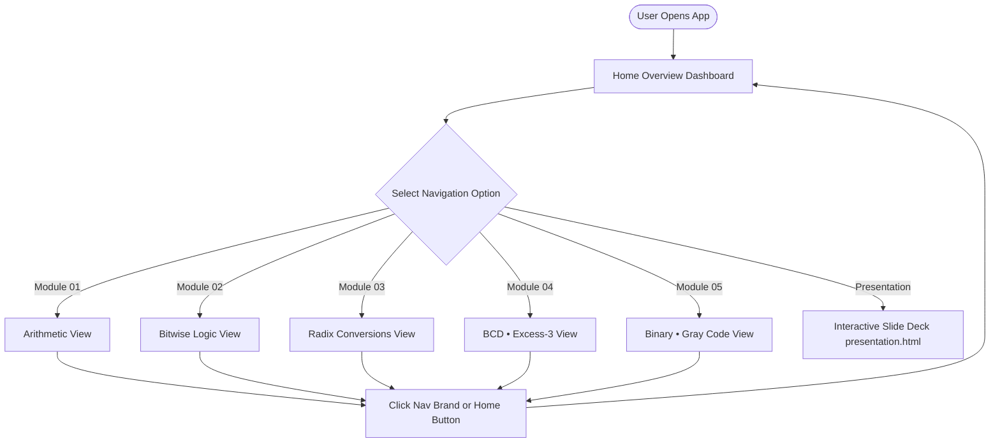
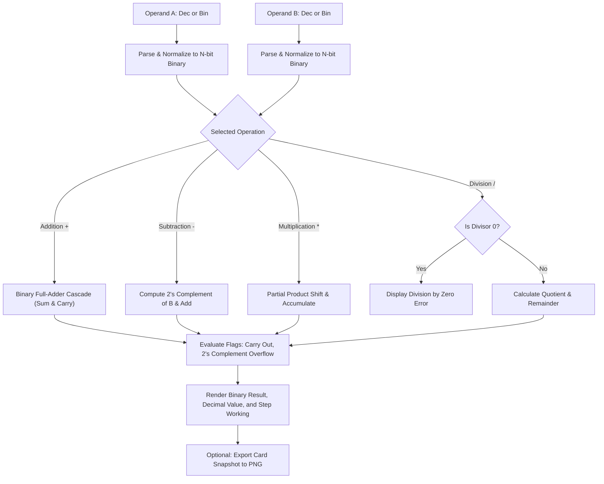
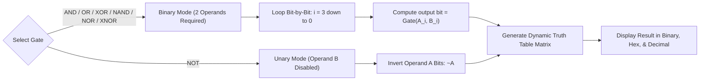
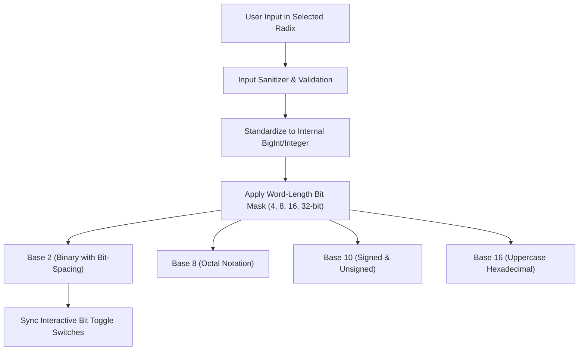
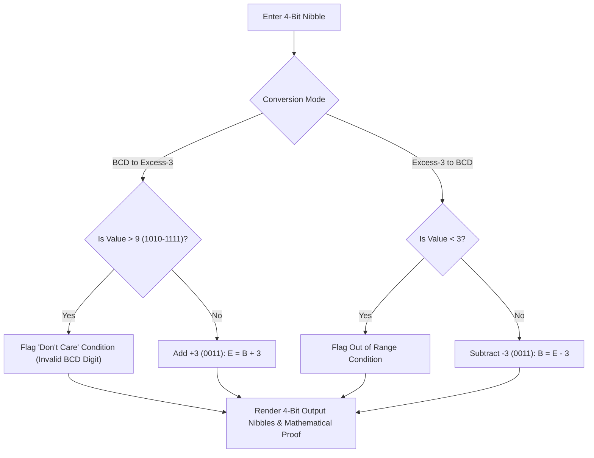
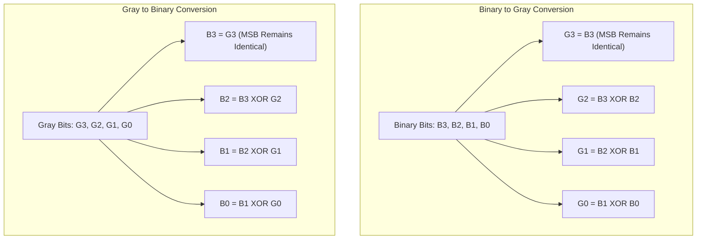

# Binary-Calculator
Interactive binary calculator and digital logic suite featuring multi-bit arithmetic, logic gates, number base conversions, BCD, Excess-3, and Gray code transformations with real-time bit toggles and step-by-step visualizers
# BinaryCraft — Binary & Digital Logic Suite

[](LICENSE)
[](https://developer.mozilla.org/en-US/docs/Web/JavaScript)
[](https://developer.mozilla.org/en-US/docs/Web/HTML)
[](https://developer.mozilla.org/en-US/docs/Web/CSS)
[](#features)

**BinaryCraft** is an interactive, browser-based digital electronics workbench designed for students, educators, and engineers. It provides interactive bit manipulation, real-time calculation, column-wise arithmetic working, and dynamic truth tables across 5 specialized digital logic modules.

---

## Table of Contents
- [System Architecture](#system-architecture)
- [Module Workflows & Flowcharts](#module-workflows--flowcharts)
  - [1. Global Navigation & View Routing](#1-global-navigation--view-routing)
  - [2. Multi-Bit Arithmetic Engine](#2-multi-bit-arithmetic-engine)
  - [3. Bitwise Logic & Truth Table Pipeline](#3-bitwise-logic--truth-table-pipeline)
  - [4. Number Base & Radix Converter](#4-number-base--radix-converter)
  - [5. BCD & Excess-3 Code Converter](#5-bcd--excess-3-code-converter)
  - [6. Binary & Gray Code Transformer](#6-binary--gray-code-transformer)
- [Modules & Feature Matrix](#modules--feature-matrix)
- [Digital Logic Specifications](#digital-logic-specifications)
- [File Structure](#file-structure)
- [Getting Started](#getting-started)
- [Presentation Slide Deck](#presentation-slide-deck)
- [License](#license)

---

## System Architecture



---

## Module Workflows & Flowcharts

### 1. Global Navigation & View Routing

The application functions as a high-performance Single Page Application (SPA) driven by semantic DOM containers with modular CSS themes:



---

### 2. Multi-Bit Arithmetic Engine

Performs unsigned and signed (2's complement) arithmetic operations with overflow heuristics and column-by-column visual carry breakdowns:



---

### 3. Bitwise Logic & Truth Table Pipeline

Evaluates bit-level operations across dual 4-bit operands or single-operand unary gates:



---

### 4. Number Base & Radix Converter

Supports conversion across **Binary (Base 2)**, **Octal (Base 8)**, **Decimal (Base 10)**, and **Hexadecimal (Base 16)** with customizable word-length masking:



---

### 5. BCD & Excess-3 Code Converter

Handles conversion between standard **8421 Binary Coded Decimal** and **Self-Complementing Excess-3 code** with Don't Care condition handling:



---

### 6. Binary & Gray Code Transformer

Converts between natural binary and reflected unit-distance Gray code:



---

## Modules & Feature Matrix

| Module | Primary Operations | Input Modes | Word Lengths | Key Highlights |
| :--- | :--- | :--- | :--- | :--- |
| **01. Arithmetic** | `+`, `−`, `×`, `÷` | Decimal, Binary | 4-bit, 16-bit | 2's Complement, Overflow & Carry detection, PNG screenshot export |
| **02. Bitwise Logic** | AND, OR, XOR, NOT, NAND, NOR, XNOR | Decimal, Binary | 4-bit | Dynamic truth table generator, auto-disable for unary NOT |
| **03. Base Conversions** | Bin, Oct, Dec, Hex | Any Radix | 4, 8, 16, 32-bit | Real-time 4-way synchronization, interactive bit switches |
| **04. BCD • Excess-3** | BCD ⇄ Excess-3 | Binary, Decimal | 4-bit nibbles | Don't Care $(X)$ detection for values $10$ through $15$ |
| **05. Gray Code** | Binary ⇄ Gray Code | Binary, Decimal | 4-bit nibbles | XOR tree breakdown, Hamming distance $(=1)$ verification |

---

## Digital Logic Specifications

### Arithmetic 2's Complement Range
- **4-Bit Unsigned Range**: $0 \le N \le 15$ ($2^4 - 1$)
- **4-Bit Signed Range**: $-8 \le N \le +7$ ($-2^3$ to $+2^3 - 1$)
- **Overflow Detection Rule**: Occurs when two operands of the same sign yield a result with the opposite sign.

### Logic Gate Truth Formulas
| Operation | Formula | Behavior |
| :--- | :--- | :--- |
| **AND** | $Y = A \cdot B$ | Output is $1$ only when all inputs are $1$ |
| **OR** | $Y = A + B$ | Output is $1$ if at least one input is $1$ |
| **XOR** | $Y = A \oplus B$ | Output is $1$ if inputs differ (odd parity) |
| **NOT** | $Y = \overline{A}$ | Bitwise inversion |
| **NAND** | $Y = \overline{A \cdot B}$ | Universal gate; inverse of AND |
| **NOR** | $Y = \overline{A + B}$ | Universal gate; inverse of OR |
| **XNOR** | $Y = \overline{A \oplus B}$ | Output is $1$ when inputs are identical |

---

## File Structure

```plaintext
Binary_Calculator/
├── index.html              # Main single-page application structure & views
├── styles.css              # Curated CSS design system with module color themes
├── app.js                  # Computation engines, bit switchers, and UI state
├── presentation.html       # Standalone interactive presentation slide deck
├── html2canvas.min.js      # Client-side screenshot exporter
├── package-lock.json       # Project package lock metadata
└── README.md               # Architecture documentation & flowcharts
```

---

## Getting Started

### Prerequisites
BinaryCraft is built with pure web technologies and requires **no external build steps or server dependencies**.

### Running the App
1. Clone or download the repository:
   ```bash
   git clone https://github.com/your-username/binary-calculator.git
   cd binary-calculator
   ```
2. Open `index.html` directly in any modern web browser:
   - Double click `index.html`, or
   - Use VS Code Live Server extension, or
   - Run a quick local HTTP server:
     ```bash
     # Using Python
     python -m http.server 8000
     # Using Node.js
     npx serve .
     ```
3. Navigate to `http://localhost:8000` (or local file URI).

---

## Presentation Slide Deck

An integrated presentation deck is included in `presentation.html` for project demonstrations, lectures, or academic reviews:
- **Slide Controls**: Use the on-screen arrows, navigation dots, or keyboard arrow keys ($\leftarrow$ / $\rightarrow$).
- **Features Highlighted**: Color-coded slide themes corresponding to each module, interactive toggle cards, and mathematical proofs.

---

## License

This project is licensed under the [MIT License](LICENSE) — free for educational and open-source use.
